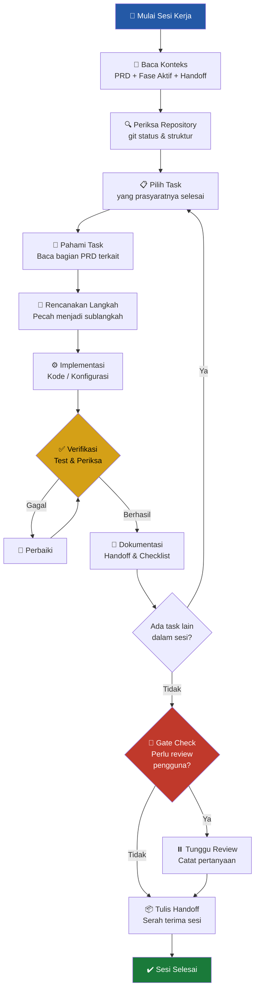
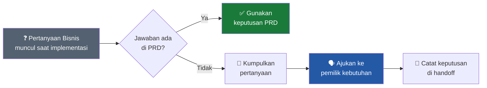
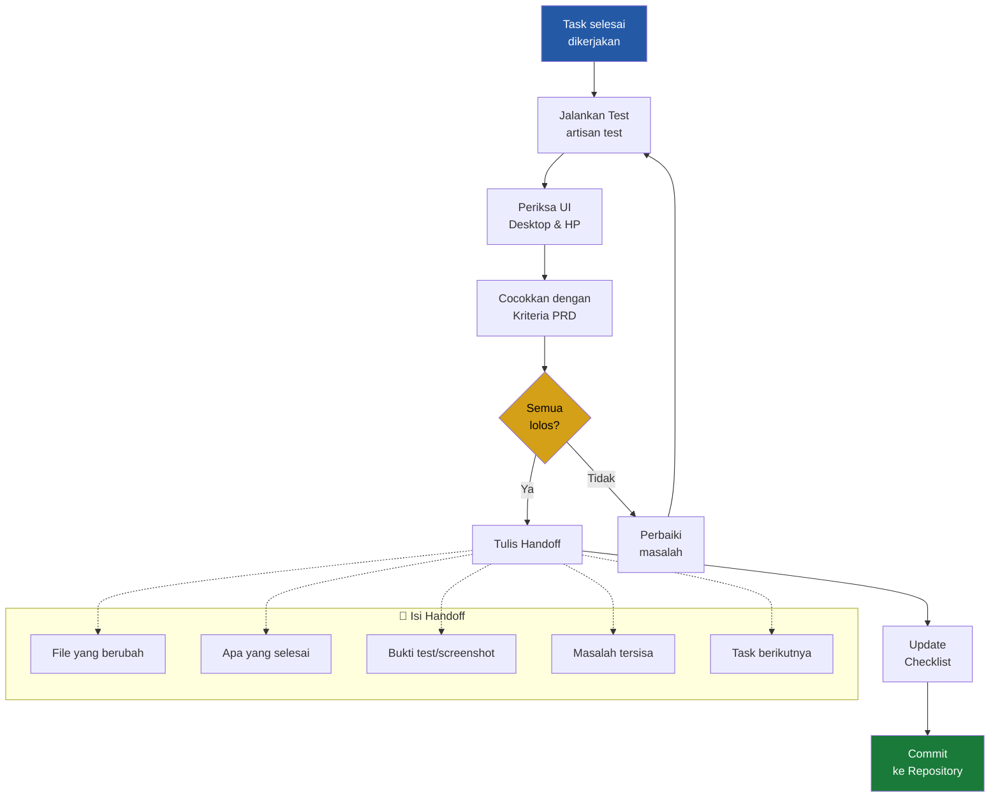

# Agent Workflow — Progress New Model

Versi 1.0 • 13 Oktober 2026

Dokumen ini mendefinisikan alur kerja (workflow) yang harus diikuti oleh AI agent saat membantu pengembangan aplikasi **Progress New Model**. Tujuannya adalah menjaga konsistensi, kualitas, dan kepatuhan terhadap PRD di setiap sesi kerja.

---

## Daftar Isi

1. [Ringkasan Proyek](#1-ringkasan-proyek)
2. [Prinsip Kerja Agent](#2-prinsip-kerja-agent)
3. [Alur Kerja Utama](#3-alur-kerja-utama)
4. [Diagram Workflow](#4-diagram-workflow)
5. [Detail Setiap Fase](#5-detail-setiap-fase)
6. [Alur Per Sesi Kerja](#6-alur-per-sesi-kerja)
7. [Aturan Pengerjaan Task](#7-aturan-pengerjaan-task)
8. [Alur Verifikasi dan Handoff](#8-alur-verifikasi-dan-handoff)
9. [Kontrak yang Tidak Boleh Dilanggar](#9-kontrak-yang-tidak-boleh-dilanggar)
10. [Penanganan Keputusan dan Ketidakpastian](#10-penanganan-keputusan-dan-ketidakpastian)

---

## 1. Ringkasan Proyek

**Progress New Model** adalah aplikasi pendataan aktivitas pengembangan new model yang menggantikan Microsoft Access. Dibangun dengan stack **Laravel 13 + Blade + Livewire 4 + Tailwind CSS 4 + PostgreSQL 18**. Digunakan oleh satu admin untuk mencatat progress kegiatan, problem, tindakan korektif, feedback customer, dan lampiran foto/dokumen.

---

## 2. Prinsip Kerja Agent

| # | Prinsip | Penjelasan |
|---|---------|------------|
| 1 | **PRD adalah sumber kebenaran** | Semua keputusan harus merujuk PRD v2.0. Tidak menambah fitur tanpa konfirmasi. |
| 2 | **Satu task per satu waktu** | Kerjakan task yang prasyaratnya sudah selesai. Jangan lompat fase. |
| 3 | **Jangan merusak yang sudah ada** | Periksa repository sebelum edit. Pertahankan kode dan data yang ada. |
| 4 | **Bukti sebelum klaim** | Jalankan verifikasi, catat hasilnya. Jangan mencentang task tanpa bukti. |
| 5 | **Tanyakan, jangan tebak** | Jika kebutuhan bisnis tidak jelas, kumpulkan pertanyaan dan minta keputusan. |
| 6 | **Handoff yang jelas** | Setiap sesi menghasilkan catatan: apa yang selesai, bukti, masalah, dan task berikutnya. |

---

## 3. Alur Kerja Utama

Proyek dikerjakan dalam **7 fase berurutan** dengan gate di setiap perpindahan fase:

```
┌─────────────────────────────────────────────────────────────────────────┐
│                     ALUR KERJA PROGRESS NEW MODEL                       │
│                                                                         │
│  FASE 01 ──► FASE 02 ──► FASE 03 ──► FASE 04 ──► FASE 05 ──► FASE 06 ──► FASE 07  │
│  Prototype   Fondasi     Project &   Problem &   Draft &     Migrasi    UAT &      │
│  & Validasi  Data        Progress    Lampiran    Status      Access     Operasi    │
│                                                                         │
│  12 tasks    9 tasks     8 tasks     9 tasks     10 tasks    9 tasks    8 tasks    │
│  ───────     ───────     ───────     ───────     ───────     ───────    ───────    │
│  TOTAL: 65 tasks                                                        │
└─────────────────────────────────────────────────────────────────────────┘
```

---

## 4. Diagram Workflow



### Alur Keputusan Bisnis



---

## 5. Detail Setiap Fase

### Fase 01 — Prototype dan Validasi Pengguna
| Aspek | Detail |
|-------|--------|
| **Jumlah Task** | 12 (P01-T01 s/d P01-T12) |
| **Tujuan** | Prototype interaktif dengan data fiktif untuk review pengguna |
| **Syarat Masuk** | Keputusan kebutuhan dan stack tersedia |
| **Syarat Keluar** | Prototype diterima pengguna; feedback penghambat diselesaikan |
| **Keluaran** | Prototype lokal, skenario review, screenshot, catatan handoff |

### Fase 02 — Fondasi Data dan Akses
| Aspek | Detail |
|-------|--------|
| **Jumlah Task** | 9 (P02-T01 s/d P02-T09) |
| **Tujuan** | Schema PostgreSQL, relasi, autentikasi, kontrak service |
| **Syarat Masuk** | P01-T12 selesai |
| **Syarat Keluar** | Schema, relasi, auth, dan test environment teruji |

### Fase 03 — Project dan Progress
| Aspek | Detail |
|-------|--------|
| **Jumlah Task** | 8 (P03-T01 s/d P03-T08) |
| **Tujuan** | Master project, identitas terkini, progress dasar |
| **Syarat Masuk** | P02-T09 selesai |
| **Syarat Keluar** | Master/progress dasar serta autofill benar |

### Fase 04 — Problem, Tindakan, dan Lampiran
| Aspek | Detail |
|-------|--------|
| **Jumlah Task** | 9 (P04-T01 s/d P04-T09) |
| **Tujuan** | Data bertingkat, feedback, foto, dokumen |
| **Syarat Masuk** | P03-T08 selesai; OP03 ditetapkan sebelum upload operasional |
| **Syarat Keluar** | Graph anak/file aman dan tidak tertukar |

### Fase 05 — Draft, Status, dan Monitoring
| Aspek | Detail |
|-------|--------|
| **Jumlah Task** | 10 (P05-T01 s/d P05-T10) |
| **Tujuan** | Autosave, konflik, Close/Reopen, dashboard |
| **Syarat Masuk** | P04-T09 selesai |
| **Syarat Keluar** | Draft, Simpan, status, dan monitoring memenuhi skenario kritis |

### Fase 06 — Migrasi Access
| Aspek | Detail |
|-------|--------|
| **Jumlah Task** | 9 (P06-T01 s/d P06-T09) |
| **Tujuan** | Ekstraksi, transformasi, rekonsiliasi, rencana cutover |
| **Syarat Masuk** | P05-T10 selesai dan salinan Access tersedia |
| **Syarat Keluar** | Dry run lengkap direkonsiliasi dan cutover direncanakan |

### Fase 07 — UAT dan Operasi
| Aspek | Detail |
|-------|--------|
| **Jumlah Task** | 8 (P07-T01 s/d P07-T08) |
| **Tujuan** | Acceptance test, UX, operasi, pilot, serah terima |
| **Syarat Masuk** | P06-T09 selesai |
| **Syarat Keluar** | UAT, restore, rilis, pilot, dan serah terima diterima |

---

## 6. Alur Per Sesi Kerja

Setiap kali agent memulai sesi baru, ikuti langkah-langkah berikut:

### Langkah 1 — Membangun Konteks
```
1. Baca PRD_Progress_New_Model.md (bagian yang dirujuk fase aktif)
2. Baca file fase yang dikerjakan (FASE_0x_*.md)
3. Baca catatan handoff terakhir (docs/progress/Pxx.md)
4. Periksa repository: git status, struktur file, pekerjaan sebelumnya
```

### Langkah 2 — Memilih dan Memahami Task
```
1. Identifikasi task yang prasyaratnya sudah selesai
2. Baca bagian PRD yang dirujuk task tersebut
3. Pahami file sasaran, langkah kerja, dan kriteria selesai
4. Pecah menjadi sublangkah yang dapat dikerjakan satu per satu
```

### Langkah 3 — Implementasi
```
1. Gunakan service/komponen yang sudah ada
2. Ikuti konvensi dan path yang sudah ditetapkan
3. Jangan membuat implementasi paralel tanpa alasan
4. Jangan menambah field, role, atau fitur di luar PRD
```

### Langkah 4 — Verifikasi
```
1. Jalankan test yang relevan (artisan test, browser test)
2. Periksa visual pada breakpoint yang ditentukan (1366, 1024, 768, 390 px)
3. Catat command yang dijalankan dan hasil aktualnya
4. Jangan mengarang hasil test
```

### Langkah 5 — Handoff
```
1. Update checklist task (centang jika kriteria selesai terpenuhi)
2. Tulis file handoff (docs/progress/Pxx.md):
   - File yang berubah
   - Apa yang selesai
   - Bukti (test output, screenshot)
   - Masalah tersisa
   - Task berikutnya
3. Commit dengan pesan yang jelas
```

---

## 7. Aturan Pengerjaan Task

### ✅ HARUS dilakukan

- Membaca PRD dan kontrak fase sebelum mengerjakan task
- Memeriksa repository sebelum mengedit file
- Menggunakan fixture fiktif pada fase prototype
- Mencatat pemetaan path jika berbeda dari rancangan
- Menjalankan verifikasi sesuai risiko task
- Menulis handoff di akhir sesi

### ❌ TIDAK BOLEH dilakukan

- Menjalankan seluruh fase dalam satu perubahan besar
- Menambah required field, role, target date, atau fitur di luar PRD
- Mereset database yang berisi data
- Mengubah aturan bisnis tanpa konfirmasi pemilik kebutuhan
- Mencentang task yang belum memenuhi kriteria selesai
- Mengklaim review/persetujuan yang belum terjadi
- Mencampur data prototype dengan data migrasi produksi
- Membuat audit trail produk, report/export, atau link antaraktivitas

---

## 8. Alur Verifikasi dan Handoff



### Template Handoff

```markdown
# Handoff — [ID Task]

## Tanggal: YYYY-MM-DD
## Fase: [Nomor Fase]
## Task: [ID dan Nama Task]

### File yang berubah
- `path/to/file1` — deskripsi perubahan
- `path/to/file2` — deskripsi perubahan

### Apa yang selesai
- [Deskripsi pekerjaan yang selesai]

### Bukti
- Command: `php artisan test --filter=NamaTest`
- Hasil: [paste output]

### Masalah tersisa
- [Jika ada]

### Task berikutnya
- [ID task berikutnya dan prasyarat yang perlu diperiksa]
```

---

## 9. Kontrak yang Tidak Boleh Dilanggar

> [!CAUTION]
> Kontrak berikut berlaku di semua fase dan tidak boleh diubah tanpa konfirmasi pemilik kebutuhan.

| ID | Kontrak |
|----|---------|
| D01 | Satu JO No untuk satu Part No dan sebaliknya. Keduanya unik. |
| D02 | Satu admin. Semua PIC diketik bebas. Tidak ada Project User atau Status Project. |
| D03 | Activity persis: Trial, Sent Sample, Send Document, Audit, Others. Form sama untuk semua. |
| D05 | Minimum proyek baru: JO No, Part No, Part Name. Minimum progress final: JO No, tanggal, Activity. |
| D06 | Satu progress → banyak problem → banyak corrective action (masing-masing punya PIC & actual date). |
| D09 | Action tidak punya target date. Tanggal kosong bukan penentu status. |
| D10 | Close manual. Closed harus Reopen sebelum diedit. Reopen menjaga seluruh isi. |
| D11 | Autosave = draft. Simpan = data final. Draft tidak masuk hitungan Open/Closed. |
| D12 | Identitas progress mengikuti master terbaru, bukan snapshot. |
| D16 | Koreksi via edit. Tidak ada audit trail produk. |
| D20 | Stack: Laravel, PostgreSQL, Blade, Livewire, Tailwind CSS. |

---

## 10. Penanganan Keputusan dan Ketidakpastian

### Ketika jawaban ada di PRD
→ Gunakan langsung. Tidak perlu bertanya ulang.

### Ketika jawaban tidak ada di PRD
1. **Kumpulkan** semua pertanyaan terkait sekaligus (jangan tanya satu per satu)
2. **Ajukan** ke pemilik kebutuhan dengan format:
   - Konteks: bagian mana yang membutuhkan keputusan
   - Opsi: alternatif yang tersedia beserta dampaknya
   - Rekomendasi: jika ada pendapat teknis
3. **Catat** keputusan di handoff agar tidak hilang
4. **Jangan** mengganti ketidakpastian dengan asumsi yang tidak dicatat

### Parameter Operasional yang Belum Ditetapkan
| ID | Parameter | Kapan Dibutuhkan |
|----|-----------|-----------------|
| OP01 | Nama dan kredensial admin awal | Sebelum deployment |
| OP02 | Konfigurasi server dan domain | Sebelum Fase 07 |
| OP03 | Batas ukuran file dan format dokumen | Sebelum upload operasional (Fase 04) |
| OP04 | Kebijakan backup dan retensi | Sebelum cutover (Fase 07) |
| OP05 | Jadwal cutover dari Access | Sebelum migrasi final (Fase 06-07) |

---

> [!NOTE]
> Dokumen ini adalah panduan kerja agent, bukan pengganti PRD. Untuk aturan bisnis lengkap, selalu merujuk ke [PRD_Progress_New_Model.md](PRD_Progress_New_Model.md).
